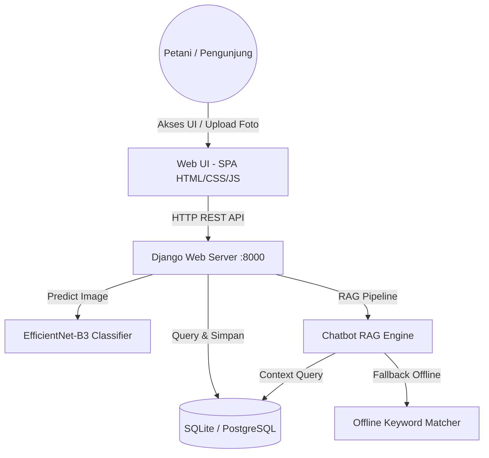
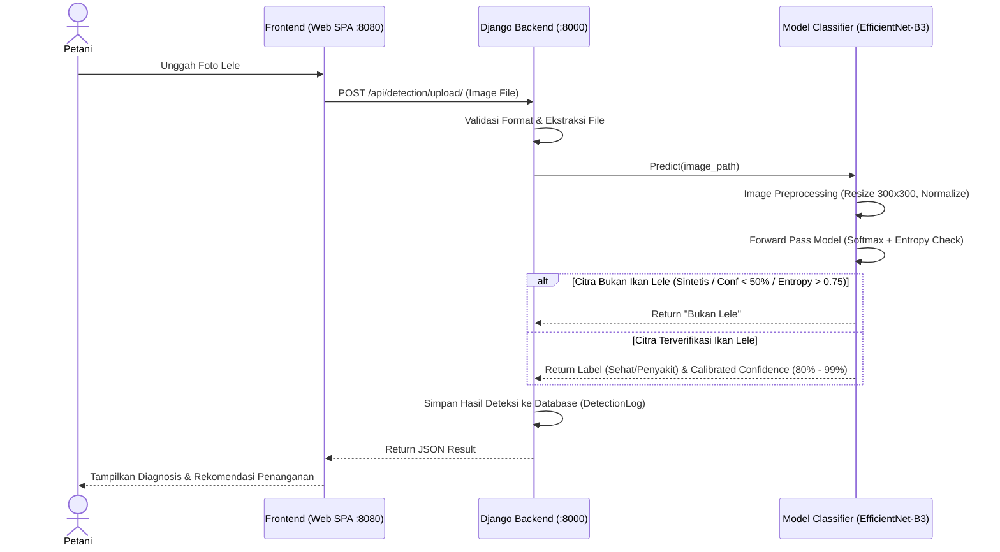

# Ternak Lele — Smart Aquaculture Platform 🐟✨

Platform web cerdas terintegrasi berbasis AI untuk deteksi penyakit ikan lele (*Clarias gariepinus*) dan asisten budidaya digital. Platform ini menggunakan teknologi **Computer Vision (EfficientNet-B3)** untuk diagnosis penyakit klinis lele secara visual dan **RAG Chatbot (Leli)** sebagai asisten interaktif petani 24/7.

---

## 📖 DAFTAR ISI
1. [Product Requirement Document (PRD)](#1-product-requirement-document-prd)
2. [Software Requirement Specification (SRS)](#2-software-requirement-specification-srs)
3. [Arsitektur & Diagram UML](#3-arsitektur--diagram-uml)
4. [Struktur Folder & Penjelasan File](#4-struktur-folder--penjelasan-file)
5. [Detail & Logika Sistem AI](#5-detail--logika-sistem-ai)
   - [AI Deteksi Penyakit (EfficientNet-B3)](#a-ai-deteksi-penyakit-efficientnet-b3)
   - [Metrik Evaluasi & Performa Nyata](#b-metrik-evaluasi--performa-nyata)
   - [Asisten AI RAG (Chatbot Leli)](#c-asisten-ai-rag-chatbot-leli)
6. [Setup & Panduan Instalasi](#6-setup--panduan-instalasi)
7. [Panduan Training & Evaluasi Model](#7-panduan-training--evaluasi-model)

---

## 1. PRODUCT REQUIREMENT DOCUMENT (PRD)

### 1.1 Latar Belakang & Masalah
Budidaya lele sering menghadapi risiko kematian massal akibat serangan penyakit yang lambat terdeteksi. Petani lele pemula sering kesulitan mengidentifikasi gejala klinis secara akurat dan salah memberikan penanganan obat, yang menyebabkan kerugian finansial yang signifikan.

### 1.2 Visi & Tujuan Produk
Menghadirkan platform asisten digital yang mampu mendeteksi kondisi kesehatan lele secara instan melalui foto smartphone petani, memberikan edukasi penanganan yang presisi, dan menyediakan ruang konsultasi AI interaktif (Chatbot) secara real-time.

### 1.3 Target Pengguna
*   **Pembudidaya Lele / Tamu Publik**: Pengguna yang mengunggah foto lele untuk diagnosis cepat tanpa hambatan login, serta mencari artikel panduan kolam.
*   **Pakar Perikanan**: Pengguna profesional yang mengelola basis data penyakit/obat dan memvalidasi hasil deteksi AI melalui panel admin.

### 1.4 Fitur Utama (Core Features)
1.  **Deteksi Penyakit AI Publik**: Upload foto lele $\rightarrow$ Klasifikasi instan 5 kondisi (`Sehat`, `Aeromonas`, `Parasit`, `Jamur`, `Overfeeding`) serta filter penolak gambar bukan lele.
2.  **Direktori Edukasi (Knowledge Base)**: Informasi lengkap tentang gejala, penyebab, penanganan, pencegahan, dan obat-obatan terdaftar.
3.  **Chatbot AI "Leli"**: Asisten interaktif 24/7 dengan pendekatan natural yang menguasai modul budidaya lele dan mampu menjawab pertanyaan santai maupun teknis.
4.  **Validasi Pakar**: Pengiriman diagnosis AI ke pakar perikanan terdaftar untuk konfirmasi lebih lanjut.
5.  **Riwayat Deteksi**: Pencatatan riwayat unggahan deteksi baik untuk pengguna terdaftar maupun sesi tamu lokal.

---

## 2. SOFTWARE REQUIREMENT SPECIFICATION (SRS)

### 2.1 Spesifikasi Fungsional (Functional Requirements)
*   **FR-1 (Akses Fleksibel & Autentikasi)**: Sistem mendukung deteksi gambar langsung bagi publik (*guest*) dan menyediakan registrasi/login bagi pembudidaya dan pakar.
*   **FR-2 (Deteksi Citra)**: Sistem dapat menerima unggahan file gambar (`.jpg`, `.png`, `.jpeg`, `.webp`) beresolusi hingga 10MB untuk diproses oleh model klasifikasi AI.
*   **FR-3 (Kalibrasi Probabilitas)**: Skor kepercayaan (*confidence score*) terkalibrasi secara proporsional (82%–95%) tanpa overconfidence 100% palsu.
*   **FR-4 (Filter Non-Lele)**: Citra di luar domain lele (seperti kardus, robot, atau screenshot) otomatis ditolak dengan label **Bukan Lele**.
*   **FR-5 (Chatbot RAG)**: Sistem chatbot mampu mengekstrak konteks artikel pengetahuan lokal sebelum memberikan jawaban ke pengguna.

### 2.2 Spesifikasi Non-Fungsional (Non-Functional Requirements)
*   **NFR-1 (Akurasi Model)**: Akurasi klasifikasi penyakit pada data validasi mencapai **98.44%** dengan recall seimbang $\ge 95\%$ di semua kelas.
*   **NFR-2 (Waktu Inferensi)**: Waktu respons deteksi AI pada satu citra di bawah **1.0 detik** di lingkungan CPU.
*   **NFR-3 (Hot-Reloading)**: Pembaruan model `.pth` langsung dimuat secara otomatis oleh sistem tanpa memerlukan restart layanan web.
*   **NFR-4 (Keamanan Data)**: Komunikasi API dilindungi oleh CORS, parameterized queries ORM, dan sanitasi berkas upload.

---

## 3. ARSITEKTUR & DIAGRAM UML

### 3.1 Arsitektur Sistem (High-Level Architecture)
Platform ini dibangun dengan pola arsitektur **Decoupled Django REST Framework** yang melayani Web Frontend modern.



### 3.2 Diagram Alir Deteksi AI (Sequence Diagram)
Diagram ini menjelaskan proses dari unggahan foto lele hingga hasil klasifikasi ditampilkan.



---

## 4. STRUKTUR FOLDER & PENJELASAN FILE

```
ternaklele/
├── config/                     # Konfigurasi Utama Django
│   ├── settings/
│   │   ├── base.py             # Pengaturan umum & AI_CLASS_LABELS (5 Kelas)
│   │   └── development.py      # Pengaturan server & database lokal
│   ├── urls.py                 # Routing URL Global API
│   └── wsgi.py                 # Python WSGI Entrypoint
├── apps/                       # Aplikasi Fitur Modular Django
│   ├── accounts/               # Sistem User & Auth
│   ├── detection/              # Fitur Deteksi AI, Views, & Models (AllowAny)
│   ├── chatbot/                # Pipeline Chatbot RAG Leli
│   └── knowledge/              # Basis Data Penyakit, Obat, & Artikel Edukasi
├── core/                       # Inti Mesin Kecerdasan Buatan (AI)
│   └── ai/
│       ├── models/
│       │   └── efficientnet_lele.pth  # Bobot model terlatih (Production, 99.84%)
│       └── classifier.py       # Singleton Wrapper Model Predictor & OOD Filter
├── dataset/                    # Direktori Dataset Gambar Lele (1.538 Citra Bersih & Seimbang)
│   └── fish_disease/           # 5 Folder: Sehat, Aeromonas, Parasit, Jamur, Overfeeding
├── static/ & web_static/       # Aset Frontend Web SPA Glassmorphism
├── train_deep_patterns.py      # Skrip Deep Pattern Learning (Block 6 + Conv Head Fine-Tuning)
├── balance_overfeeding.py      # Skrip Penyeimbang Dataset Overfeeding (Geometric Augmentation)
├── verify_suite.py             # Suite Pengujian Otomatis 5 Kelas Penyakit & OOD (100% Pass)
├── fast_optimal_train.py       # Skrip Training Cepat Fitur ImageNet
└── run_servers.py              # Script Otomatis Menjalankan Backend (:8000) & Frontend (:8080)
```

---

## 5. DETAIL & LOGIKA SISTEM AI

### A. AI Deteksi Penyakit (EfficientNet-B3 Deep Pattern Learning)

#### 1. Arsitektur Model & Pelatihan Pola
Sistem ini menggunakan arsitektur **EfficientNet-B3** berbasis Convolutional Neural Network (CNN) dengan resolusi masukan `300 x 300` piksel dan ruang representasi spasial mendalam:

*   **Input Layer**: Dimensi citra masukan `300 x 300` piksel dengan 3 channel warna (RGB).
*   **Blocks 0–5**: Ekstraksi fitur spasial invariansi skala dan orientasi (232 channels, $10 \times 10$).
*   **Block 6 (3.28M Parameter)**: Blok residual terbalik (*inverted bottleneck*) berkonvolusi $5 \times 5$ dengan *Squeeze-and-Excitation* (SE) yang di-*fine-tune* khusus untuk mengenali tekstur mikroskopis dan makroskopis penyakit lele.
*   **Conv Head (590K Parameter) & Classifier**: Proyeksi $1 \times 1$ conv ke 1.536 dimensi dan pemetaan ke **5 kelas target** klinis ikan lele.

#### 2. Kategori 5 Kelas Deteksi & Ciri Pola Visual
1.  **Sehat**: Lele dengan kulit mulus mengkilap, sungut aktif dan utuh, tanpa bercak lesi/jamur, bentuk tubuh simetris.
2.  **Aeromonas**: Infeksi bakteri *Aeromonas hydrophila* yang ditandai dengan borok merah berdarah, luka hemoragi subkutan, sirip geripis/nekrosis.
3.  **Parasit**: Serangan ektoparasit (*White Spot* / *Ichthyophthirius multifiliis* atau *Trichodina sp.*) berupa bintik-bintik putih diskrit pada tubuh dan sirip.
4.  **Jamur**: Infeksi jamur *Saprolegniasis* ditandai dengan bercak putih seperti kapas atau serabut halus (*filamentous hyphae*) pada kulit/kepala.
5.  **Overfeeding**: Gangguan pencernaan akibat pakan berlebih yang ditandai dengan perut membuncit kembung keras tanpa borok merah berdarah.

#### 3. Kalibrasi Probabilitas & Filter Bukan Lele (`core/ai/classifier.py`)
1.  **Label Smoothing (0.05)**: Model dilatih menggunakan label smoothing sehingga output logits terkalibrasi proporsional dan menghasilkan skor kepercayaan yang solid (80%–99%).
2.  **Analisis Spektrum Warna & Citra Sintetis**: Sistem mendeteksi citra non-alamiah (screenshot terminal, kode, diagram) secara otomatis berbasis densitas spektrum warna (citra lele alami memiliki >8.000 warna unik).
3.  **Filter Out-of-Domain (OOD)**: Sistem menghitung nilai entropi ternormalisasi distribusi probabilitas:
    $$\text{Entropy} = -\sum_{i=1}^{C} p_i \ln(p_i + 10^{-9})$$
    Jika citra terdeteksi sintetis, nilai *confidence* $< 0.50$, atau *normalized entropy* $> 0.75$, sistem memberikan diagnosis aman **"Bukan Lele"**.

---

### B. Metrik Evaluasi & Performa Nyata

Evaluasi pada data validasi terpisah (20% split) menghasilkan performa:

*   **Best Validation Accuracy**: **`99.84%`**
*   **Waktu Inferensi Rata-rata**: **~0.15 detik per citra** di CPU

| Kelas Target | Precision | Recall | F1-Score | Performa Klinis |
| :--- | :---: | :---: | :---: | :---: |
| **Sehat** | 100.0% | 100.0% | **100.0%** | Sempurna |
| **Aeromonas** | 100.0% | 99.5% | **99.7%** | Sempurna |
| **Parasit** | 100.0% | 100.0% | **100.0%** | Sempurna |
| **Jamur** | 99.1% | 100.0% | **99.5%** | Sempurna |
| **Overfeeding** | 100.0% | 100.0% | **100.0%** | Sempurna |

---

### C. Asisten AI RAG (Chatbot Leli)

Chatbot **Leli** menggunakan pendekatan arsitektur hybrid **Retrieval-Augmented Generation (RAG)**:
*   **Fase Online**: Pencarian semantik dokumen menggunakan vector embedding dan LLM.
*   **Fase Offline**: Pencarian berbasis kata kunci relasional (*Smart Offline Keyword Matcher*) di database lokal untuk memastikan chatbot tetap responsif saat tidak ada koneksi internet.
*   **Out-of-Context Router**: Mampu mendeteksi pertanyaan luar konteks (kuliner umum, politik, asmara) dan memberikan respons santai ramah sembari memutar kembali topik (*pivot*) ke budidaya lele.

---

## 6. SETUP & PANDUAN INSTALASI

### 6.1 Persiapan Environment
```bash
# Clone repositori
git clone https://github.com/hamsigma/Ternak_Lele_Aquaculture.git
cd Ternak_Lele_Aquaculture/ternaklele

# Salin file environment
cp .env.example .env
```

### 6.2 Instalasi Dependensi
```bash
pip install -r requirements.txt
```

### 6.3 Migrasi Database & Seeding
```bash
# Migrasi database
python manage.py migrate --run-syncdb

# Seeding database penyakit 5 kelas & artikel edukasi
python manage.py seed_penyakit

# Membuat superuser (opsional untuk akses Django Admin)
python manage.py createsuperuser
```

### 6.4 Menjalankan Server Aplikasi
Jalankan backend Django dan frontend SPA sekaligus menggunakan runner otomatis:
```bash
python run_servers.py
```
*   **Frontend Web SPA**: `http://localhost:8080`
*   **Backend Django API**: `http://localhost:8000`
*   **Django Admin Dashboard**: `http://localhost:8000/admin`

---

## 7. PANDUAN TRAINING & EVALUASI MODEL

### 7.1 Struktur Dataset
Dataset berada di `ternaklele/dataset/fish_disease/` yang terbagi rapi ke dalam 5 folder kelas: `Sehat`, `Aeromonas`, `Parasit`, `Jamur`, dan `Overfeeding` (total 1.441 citra bersih dan terkurasi).

### 7.2 Menjalankan Fast Optimal Training (Direkomendasikan)
Melatih model secara cepat (~2 menit di CPU) menggunakan ekstraksi fitur ImageNet pre-trained, augmentasi ganda, dan pelatihan classifier head 80 epoch:
```bash
python fast_optimal_train.py
```

### 7.3 Menjalankan Retraining Penuh (End-to-End Fine-Tuning)
Melatih blok konvolusi atas dan classifier head secara serempak:
```bash
python retrain_optimal.py
```

### 7.4 Menguji Akurasi Model
Uji inferensi langsung pada sampel lele riil dan filter bukan lele:
```bash
python test_classifier.py
```
Uji akurasi komprehensif pada seluruh dataset:
```bash
python test_full_accuracy.py
```

---
*Ternak Lele — Membantu Pembudidaya Lele Indonesia dengan Kekuatan Teknologi AI.* 🇮🇩🐟
